# Blast Radius Incident Response Agent

> **Graph-Native Incident Response Agent Powered by FalkorDB, Model Context Protocol (MCP), and LLMs.**
>
> **Hackathon Track:** *Agents That Act on Connected Data* (Graph Hacks, Oct 15–18, 2026)

[](https://github.com/HelixAthu/Agents-That-Act-on-Connected-Data/actions/workflows/ci.yml)
[](https://www.falkordb.com/)
[](https://modelcontextprotocol.io/)
[](https://opensource.org/licenses/MIT)

---

## 1. Overview & Pitch

In modern cloud environments, an alert rarely tells the whole story. A critical CVE on a payment gateway might appear isolated until you discover an obscure IAM delegation chain allowing lateral movement straight into unencrypted PII databases. Conversely, an engineer might prematurely shut down a core configuration service—triggering an unrecoverable platform outage for 17 upstream services—over a vulnerability with zero reachable data exposure.

The **Blast Radius Incident Response Agent** is a graph-native cybersecurity and reliability copilot. Built on **FalkorDB**, the **Model Context Protocol (MCP)**, and modern LLM tool-calling architectures, it dynamically navigates complex infrastructure topology to:
1. **Trace lateral attack paths** from compromised services to crown jewel data stores across services, IAM roles, and databases in `<5ms`.
2. **Compute reverse failure blast radius** across dependency DAGs to assess platform outage scope.
3. **Calculate deterministic risk scores** (0.0 to 1.0) mathematically—never guessing or hallucinating risk metrics.
4. **Enforce hard safety policy gates** requiring human sign-off on customer-facing isolations and rejecting actions that would trigger catastrophic downtime.
5. **Verify containment efficacy in real time** by re-evaluating graph reachability post-action and providing 1-click reversible rollback.

```
+--------------------------------------------------------------------------------------------------+
|                                    BLAST RADIUS AGENT CANVAS                                     |
|                                                                                                  |
|   [svc-payments-gateway] ===(ASSUMES_ROLE)===> [role-storage-manager]                            |
|             ||                                           ||                                      |
|       (DEPENDS_ON)                                  (CAN_ASSUME)                                 |
|             \/                                           \/                                      |
|       [svc-billing] ===(CONNECTS_TO)===> [role-data-admin] ===(CAN_ACCESS)===> [db-cust-profile] |
|             ||                                                                      (PII)        |
|             \/                                                                                   |
|      [db-user-billing] (PII)                                                                     |
+--------------------------------------------------------------------------------------------------+
```

### Demo Video Walkthrough
📺 **Watch the 2.5-minute submission demo:** [Demo Video Walkthrough](https://youtu.be/placeholder-blast-radius-agent-demo) | Detailed presenter script: [docs/demo_script.md](docs/demo_script.md)

---

## 2. Why the Graph is Load-Bearing

| Operational Capability | FalkorDB Graph Engine Feature | Why a Relational or Flat Store Fails |
|---|---|---|
| **Multi-Hop Attack Path Discovery** | Directed multi-hop pathfinding across heterogeneous edge types (`[:DEPENDS_ON\|CONNECTS_TO\|ASSUMES_ROLE\|CAN_ASSUME\|CAN_ACCESS*..6]`). | Relational stores require unbounded recursive SQL joins (`JOIN` explosions) that degrade exponentially with path length (`O(N^k)`). Flat document stores cannot model multi-hop IAM delegation chains. |
| **Reverse Failure Blast Radius** | Subgraph reverse DAG traversal (`MATCH (imp:Service)-[:DEPENDS_ON*1..{HOPS}]->(f)`). | Relational recursive CTEs choke on circular or deep dependencies. Flat stores only index 1-hop dependencies, missing indirect cascades. |
| **Real-Time Boundary Containment** | Dynamic edge property evaluation (`WHERE ALL(r IN relationships(p) WHERE r.isolated = false)`). | Relational databases require locking millions of rows or executing cascade table updates, making sub-5ms path severance impossible. |
| **Structural Criticality Ranking** | Transitive dependent aggregation and graph centrality algorithms. | Calculating global dependency importance in document or flat stores requires full table scans and external batch map-reduce jobs. |
| **Sub-5ms Execution Latency** | GraphBLAS sparse matrix linear algebra executing in-memory graph traversals. | Traditional databases spend significant CPU cycles serializing, joining, and filtering row buffers. FalkorDB matrix operations resolve paths in milliseconds. |

---

## 3. Architecture

```mermaid
flowchart TD
    subgraph Frontend["Frontend (Vite + React + Tailwind + React Flow)"]
        Canvas["Interactive Graph Canvas\n(Dagre Auto-Layout & Node Status)"]
        TraceFeed["Real-Time Trace Feed\n(Expandable Cypher & Tool Metrics)"]
        RiskGauge["Deterministic Risk Panel\n(Severity, PII, Blast, Centrality)"]
        ApprovalCard["Human-In-The-Loop Approval\n(Dry-Run Delta & Action Buttons)"]
    end

    subgraph BackendAPI["Backend API (FastAPI)"]
        SSE["SSE Event Bus Stream\n(/incidents/{id}/events)"]
        ActionRouter["Approval & Rollback Router\n(/actions/{id}/approve)"]
        GraphEndpoint["Topology Provider\n(/graph)"]
    end

    subgraph AgentLayer["Agent Orchestration"]
        LiveAgent["Live Agent Loop\n(Claude 3.5 Sonnet / Gemini 2.5 Flash)"]
        MockAgent["Scripted Mock Agent\n(Zero-Cost Replay & Deterministic Evals)"]
        Bridge["MCP Bridge Client\n(Tool Translation & Summary Parser)"]
    end

    subgraph SafetyGate["Safety & Policy Layer"]
        PolicyGate["Hard Containment Policy Gate\n(Truth Table & Action State Machine)"]
        RiskEngine["Pure Deterministic Risk Scoring\n(G8 Formula & Component Breakdown)"]
    end

    subgraph MCP["Model Context Protocol (FastMCP)"]
        Server["MCP Server (11 Registered Tools)"]
    end

    subgraph Storage["Graph Infrastructure"]
        FalkorDB[("FalkorDB Engine\n(GraphBLAS Matrix Operations)")]
    end

    Frontend <-->|SSE Stream & HTTP POST| BackendAPI
    BackendAPI <--> AgentLayer
    AgentLayer <--> SafetyGate
    SafetyGate <--> MCP
    MCP <--> Server
    Server <-->|Cypher & Mutations| FalkorDB
```



---

## 4. Graph Data Model

The infrastructure graph models an enterprise cloud topology comprising services, data stores, IAM credentials, vulnerabilities, and engineering ownership.

### 4.1 Node Types (41 Entity Nodes)

| Label | Count | Primary Attributes | Role in Incident Response |
|---|:---:|---|---|
| `Service` | 20 | `id`, `name`, `tier` (1-3), `customer_facing` (bool), `status` | Target of vulnerabilities; origin of lateral movement; subject of outage impact. |
| `Database` | 5 | `id`, `name`, `technology`, `contains_pii` (bool), `status` | Crown jewel assets; targets of attack paths. |
| `IAMRole` | 6 | `id`, `name`, `max_session_duration`, `admin_privileges` (bool) | Privileged delegation bridges enabling lateral traversal across services. |
| `Vulnerability`| 5 | `id`, `cve_id`, `cvss_score` (float), `exploitable` (bool) | Triggers alerts; supplies base severity weight to risk formulas. |
| `Team` | 5 | `id`, `name`, `pagerduty_escalation`, `slack_channel` | Incident owners notified during outage cascades or containments. |
| `Incident` | *Audit* | `id`, `title`, `type`, `status`, `created_at` | Root incident node linking analytical findings and containment actions. |
| `Finding` | *Audit* | `id`, `kind`, `summary`, `risk_score`, `created_at` | Immutable security analysis findings evidenced by graph queries. |
| `Action` | *Audit* | `id`, `type`, `target_id`, `status`, `policy_decision`, `reversed` | Containment action log supporting multi-stage approval and rollback. |

### 4.2 Relationship Types (93 Edges)

| Edge Type | Cardinality | Properties | Semantics |
|---|:---:|---|---|
| `DEPENDS_ON` | 49 | `critical` (bool), `isolated` (bool) | Service-to-service or service-to-database dependency. |
| `CONNECTS_TO` | 6 | `isolated` (bool) | Direct network connection from service to database. |
| `ASSUMES_ROLE` | 6 | `isolated` (bool) | Service assumes an IAM role credential. Target of surgical revocation. |
| `CAN_ASSUME` | 2 | `isolated` (bool) | IAM role cross-account or lateral assumption of another IAM role. |
| `CAN_ACCESS` | 5 | `isolated` (bool) | IAM role policy grant allowing read/write access to a database. |
| `AFFECTS` | 5 | — | Links an identified CVE vulnerability to an exposed service. |
| `OWNS` | 20 | — | Links an engineering team to owned services and databases. |
| `FOUND` | *Audit* | — | Connects `Incident` to generated `Finding` nodes. |
| `EVIDENCED_BY`| *Audit* | — | Connects `Finding` to graph entity nodes serving as proof. |
| `TOOK` | *Audit* | — | Connects `Incident` to proposed or executed `Action` nodes. |

---

## 5. Queries and Traversal Algorithms

The agent's capabilities rely on deterministic, parameterized Cypher queries and topological algorithms:

- **`Q-CONTEXT`:** Deep inspection of node metadata, CVE details, owners, and incoming/outgoing edges without cartesian products.
- **`Q-ATTACK`:** Directed multi-hop pathfinding from an entrypoint service to databases with `contains_pii: true` honoring `r.isolated = false`.
- **`Q-IMPACT`:** Reverse traversal across `DEPENDS_ON|CONNECTS_TO` edges to aggregate all upstream customer-facing services affected by an outage.
- **`Q-RANK`:** Structural criticality ranking via transitive dependent counts.
- **`Q-ISOLATE-NODE` & `Q-REVOKE-ROLE`:** Surgical containment mutations setting `r.isolated = true`.
- **`Q-ROLLBACK-NODE` & `Q-ROLLBACK-ROLE`:** Symmetrical, reverse-chronological containment rollbacks.

*For complete Cypher syntax, execution plans, and Golden Benchmark results (G1 through G9), see [docs/queries.md](docs/queries.md).*

---

## 6. Model Context Protocol (MCP) Tools

The agent interacts exclusively with infrastructure through 11 strictly typed MCP tools:

| Tool Name | Operation Mode | When to Use | When NOT to Use |
|---|:---:|---|---|
| `get_component_context` | Read-Only | Investigating initial alerts; inspecting node properties, CVEs, owners, and direct edges. | Do not use for multi-hop blast radius or pathfinding. |
| `find_attack_paths` | Read-Only | Finding lateral movement chains to PII crown jewels from compromised services. | Do not use for reverse outage cascades. |
| `get_failure_impact` | Read-Only | Computing reverse blast radius of service or database outages. | Do not use for forward security lateral reachability. |
| `rank_critical_components`| Read-Only | Identifying top infrastructure dependencies by transitive dependents. | Do not use for component-specific alerts. |
| `compute_risk` | Read-Only | Calculating mathematical composite risk score (0.0 to 1.0). | The LLM must NEVER compute risk scores directly. |
| `propose_containment` | Validation | Submitting an action (`ISOLATE_NODE`, `REVOKE_ROLE`) to policy gate evaluation. | Does not execute or mutate the graph. |
| `execute_containment` | Write Mutation | Executing an `AUTO`-approved or human-approved action in FalkorDB. | Do not use on `DENIED` actions or without required approval. |
| `rollback_action` | Write Mutation | Restoring previously isolated nodes or revoked roles to healthy state. | Do not use to create new containment boundaries. |
| `notify_owners` | Side Effect | Dispatching outbox notifications to service owning teams. | Does not modify graph topology or containment. |
| `record_finding` | Audit Write | Writing immutable findings and evidence links into the incident audit trail. | Does not perform active containment. |
| `run_readonly_cypher` | Read-Only | Executing ad-hoc read-only Cypher queries with strict keyword guardrails. | Disallows all mutations (`CREATE`, `SET`, `DELETE`, etc.). |

---

## 7. Safety Model and Policy Gates

Autonomous containment actions in production environments carry extreme operational risk. The agent enforces a **zero-trust safety boundary**:

### 7.1 Policy Truth Table

| Action | Condition / Context | Policy Decision | Operational Rationale |
|---|---|:---:|---|
| `ISOLATE_NODE` | No verified attack path to PII database | **`DENIED`** | Prevents unwarranted outages; false alarms must not disrupt production. |
| `ISOLATE_NODE` | Target is Tier 1 AND Customer-Facing | **`APPROVAL_REQUIRED`** | Critical revenue paths mandate explicit human sign-off. |
| `ISOLATE_NODE` | Composite Risk $\ge 0.8$ (and non-tier 1 CF) | **`AUTO`** | Autonomous containment permitted for severe, verified active threats. |
| `ISOLATE_NODE` | All other verified scenarios | **`APPROVAL_REQUIRED`** | Default safe fallback for moderate impact services. |
| `REVOKE_ROLE` | Edge not on any verified attack path | **`DENIED`** | Prevents accidental credential disruption. |
| `REVOKE_ROLE` | Composite Risk $\ge 0.5$ on verified attack path | **`AUTO`** | Surgical IAM revocation severs attack paths with minimal blast radius. |

### 7.2 Safety Invariants
- **Reversibility:** Every containment action is strictly reversible via `rollback_action` in reverse chronological order.
- **Read-Only Escape Hatch:** `run_readonly_cypher` blocks all mutating Cypher keywords (`SET`, `DELETE`, `MERGE`, `CREATE`, `DROP`).
- **Concurrency Serialization:** All containment writes are serialized via an asynchronous mutex lock (`_CONTAINMENT_LOCK`) to eliminate race conditions.

---

## 8. Quickstart & Local Setup

### Prerequisites
- Docker & Docker Compose
- Python 3.11+
- Node.js 18+ and npm

### 1. Launch FalkorDB
```bash
docker compose up -d
```
Verify FalkorDB is healthy:
```bash
docker compose ps
```

### 2. Configure Backend Environment
```bash
python3 -m venv .venv
source .venv/bin/activate
pip install -r requirements.txt
cp .env.example .env
```
*(Optional: add `ANTHROPIC_API_KEY` or `GEMINI_API_KEY` to `.env` to enable live LLM mode. Scripted mock mode runs without keys).*

### 3. Seed Graph Database
```bash
python seed/seed_graph.py --reset
```

### 4. Execute Test Suites
```bash
# Verify backend unit and integration tests (seed, queries, scoring, policy, mcp, api, evals)
pytest

# Verify frontend test suites
npm --prefix frontend test
```

### 5. Launch Full Stack
Start the backend server (port 8000):
```bash
uvicorn backend.main:app --host 0.0.0.0 --port 8000 --reload
```

Start the frontend Vite application (port 5173):
```bash
npm --prefix frontend install
npm --prefix frontend dev
```
Open [http://localhost:5173](http://localhost:5173) in your browser.

---

## 9. Canonical Scenarios

The system includes 4 benchmark scenarios demonstrating end-to-end capabilities:

- **Scenario A: Lateral Attack Path on Payment Gateway (`svc-payments-gateway`)**
  - Exploitable CVE-2026-9901 (CVSS 9.8) detected.
  - FalkorDB uncovers 2 attack paths to PII, including the hidden IAM delegation chain (`svc-payments-gateway` → `role-storage-manager` → `role-data-admin` → `db-customer-profile`).
  - Agent automatically revokes the IAM role (`AUTO`), reducing paths from 2 to 1.
  - Agent proposes isolating `svc-payments-gateway`; policy gate flags `APPROVAL_REQUIRED` (Tier 1 customer-facing).
  - Human approves on the UI; agent isolates node; paths drop from 1 to 0; attack path vanishes.
- **Scenario B: Outage Cascade on Core Orders Database (`db-orders`)**
  - Database failure alert triggers reverse blast radius analysis (`Q-IMPACT`).
  - Identifies 8 impacted upstream services (6 customer-facing) across 4 engineering teams.
  - Agent dispatches outbox notifications to all 4 owning teams and records findings without unwarranted isolation.
- **Scenario C: Config Service CVE False Alarm (`svc-config`)**
  - High severity CVE-2026-4418 reported on `svc-config`.
  - FalkorDB reveals 0 attack paths to PII databases and 17 transitive upstream dependents.
  - Isolation proposal is strictly **`DENIED`** by policy gate, preventing a catastrophic platform outage.
- **Scenario A2: Vague Suspicious Activity Alert (`svc-web-portal`)**
  - Vague alert evaluates tool selection and restraint.
  - Agent inspects context, calculates low risk (0.15), verifies 0 attack paths, and avoids unnecessary containment.

---

## 10. Evaluation Benchmark Results

The automated benchmark harness (`evals/eval_harness.py`) evaluates scenarios against quantitative criteria:

| Scenario | Mode | Tool Match | Zero Hallucinations | Policy Gate Compliance | Containment Efficacy | Tool Call Budget | Latency | Status |
|:---:|:---:|:---:|:---:|:---:|:---:|:---:|:---:|:---:|
| **A** | `mock` | ✅ Yes | ✅ 0 Hallucinations | ✅ 100% | ✅ Effective (2→0) | 12 / 12 | 205ms | ✅ **PASS** |
| **B** | `mock` | ✅ Yes | ✅ 0 Hallucinations | ✅ 100% | ✅ Effective | 5 / 12 | 34ms | ✅ **PASS** |
| **C** | `mock` | ✅ Yes | ✅ 0 Hallucinations | ✅ 100% | ✅ Safe Rejection | 6 / 12 | 42ms | ✅ **PASS** |
| **A2** | `mock` | ✅ Yes | ✅ 0 Hallucinations | ✅ 100% | ✅ Restrained | 4 / 12 | 24ms | ✅ **PASS** |

*Pass Rate: 100.0% (4/4 passed). Full benchmark results and flat-store baseline comparisons are documented in [evals/results.md](evals/results.md).*

---

## 11. AI Assistance Disclosure

In compliance with hackathon regulations:
- **Ideation & Architecture:** Human architects designed the multi-hop attack path schema, the deterministic risk scoring formula, the containment policy truth table, and the MCP safety boundaries.
- **AI Acceleration:** AI assistants (Claude, Gemini, Antigravity) were utilized for code generation acceleration, boilerplate scaffolding, test case expansion, and documentation drafting.
- **Verification & Ownership:** Every line of code, Cypher query, and test was human-reviewed, executed, and verified against local FalkorDB instances and automated test suites.

---

## 12. Known Limitations & Scope

- **Synthetic Topology:** The infrastructure topology is a representative enterprise model (41 nodes, 93 edges) designed to test all graph edge cases.
- **Simulated Containment:** Actions set graph boundary flags (`isolated: true`) rather than calling live AWS IAM or Kubernetes network policy APIs.
- **Traversal Post-Filtering:** Certain FalkorDB releases apply `WHERE` clauses as post-filters after `shortestPath()`. A transparent BFS fallback (`pathfinder_fallback.py`) is included to ensure shortest unisolated paths are guaranteed across all versions.

---

## 13. License

This project is licensed under the MIT License — see the [LICENSE](LICENSE) file for details.
