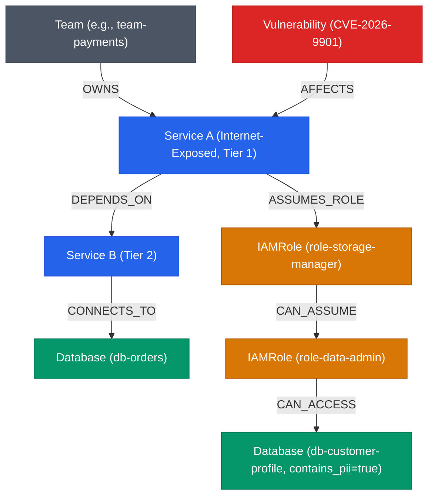

# System Architecture & Graph Data Model

## 1. Problem Statement

Modern microservice architectures feature complex, interdependent topologies consisting of services, databases, IAM roles, and organizational ownership structures. When an incident occurs—such as the discovery of a critical vulnerability on an internet-facing service or the unexpected failure of a backend database—security and operations teams face two foundational challenges:

1. **Failure Impact & Blast Radius:** Traditional systems store dependencies in flat lists, CMDB tables, or distributed trace spans. Tracing cascading outages through multiple tiers of synchronous dependencies to identify affected customer-facing endpoints and responsible on-call teams is slow and error-prone.
2. **Hidden Multi-Hop Attack Paths:** Lateral movement and privilege escalation exploit combined relationships across disparate domains: a service depends on another service, assumes an IAM role, assumes an administrative role via role-chaining misconfigurations, and accesses high-criticality databases containing Personally Identifiable Information (PII). Flat data stores cannot efficiently traverse these heterogeneous multi-hop paths.

The **Blast-Radius Agent** operates directly on connected data stored in **FalkorDB**. By modeling the infrastructure as a native graph and exposing graph traversal primitives via the Model Context Protocol (MCP), an LLM-powered incident response agent can discover non-obvious blast radius paths, calculate deterministic risk scores, enforce policy-gated containment actions, and execute verified mitigations with rollback capability.

---

## 2. Graph Data Model

### 2.1 Node Entities

| Node Label | Identifier Prefix | Key Properties | Description |
|---|---|---|---|
| `Service` | `svc-*` | `id`, `name`, `tier` (1, 2, 3), `customer_facing` (bool), `internet_exposed` (bool), `environment`, `status` | Microservices and application workloads |
| `Database` | `db-*` | `id`, `name`, `type`, `contains_pii` (bool), `region`, `criticality` ("high", "medium", "low") | Data stores and persistent state |
| `IAMRole` | `role-*` | `id`, `name`, `permission_level` ("high", "medium", "low"), `is_admin` (bool) | Cloud IAM roles and permission boundaries |
| `Vulnerability` | `vuln-*` | `id`, `cve`, `severity` ("critical", "high", "medium", "low"), `cvss` (float), `exploitable` (bool), `title` | Security advisories and CVEs affecting services |
| `Team` | `team-*` | `id`, `name`, `slack_channel`, `email` | Engineering and operations teams responsible for services |
| `Incident` | `inc-*` | `id`, `scenario_id`, `alert_text`, `status`, `timestamp` | Dynamic operational or security incident event |
| `Finding` | `finding-*` | `id`, `incident_id`, `category`, `evidence`, `severity` | Discoveries and blast radius analysis artifacts |
| `Action` | `act-*` | `id`, `incident_id`, `type`, `target`, `status`, `reverted` | Containment and mitigation operations executed |

### 2.2 Edge Relationships

Every edge in the graph contains an `isolated` boolean property (seeded as `false`).

| Relationship Type | Source (`src`) | Target (`dst`) | Properties | Semantics |
|---|---|---|---|---|
| `DEPENDS_ON` | `Service` | `Service` | `critical` (bool), `isolated` (bool) | Upstream service dependency (`src` depends on `dst`) |
| `CONNECTS_TO` | `Service` | `Database` | `access` ("rw" \| "ro"), `isolated` (bool) | Direct service data store connection |
| `ASSUMES_ROLE` | `Service` | `IAMRole` | `isolated` (bool) | Workload identity role association |
| `CAN_ASSUME` | `IAMRole` | `IAMRole` | `isolated` (bool) | IAM role-chaining / trust policy relationship |
| `CAN_ACCESS` | `IAMRole` | `Database` | `level` ("admin" \| "write" \| "read"), `isolated` (bool) | Role-based data store access rights |
| `AFFECTS` | `Vulnerability` | `Service` | `isolated` (bool) | CVE presence mapping to a service |
| `OWNS` | `Team` | `Service` | `isolated` (bool) | Organizational responsibility mapping |

---

## 3. Traversal-Direction Conventions

A fundamental architectural principle of this system is the formal separation of graph traversal directions based on operational intent:

```
[Service A] --[:DEPENDS_ON]--> [Service B]
```

### 3.1 Failure Propagation (Outage Blast Radius)
- **Convention:** Walks edges **backward** (`<-[:DEPENDS_ON]-`).
- **Rationale:** If `Service B` experiences an outage or performance degradation, the impact flows to any component that depends on `B`. Tracing backward from `B` reveals all direct and transitive callers up to Tier 1, customer-facing, and internet-exposed entry points.

### 3.2 Attacker Reach (Compromise Lateral Movement)
- **Convention:** Walks edges **forward** (`-[:DEPENDS_ON | :CONNECTS_TO | :ASSUMES_ROLE | :CAN_ASSUME | :CAN_ACCESS]->`).
- **Rationale:** If `Service A` is compromised (e.g. via an internet-facing vulnerability), an adversary moves forward along network calls (`DEPENDS_ON`), database access (`CONNECTS_TO`), or IAM credentials (`ASSUMES_ROLE -> CAN_ASSUME -> CAN_ACCESS`).

---

## 4. Graph Architecture Diagram



---

## 5. Containment & Non-Destructive Isolation Semantics

Mitigation actions taken by the agent must be safe, verifiable, and completely reversible:

- **Soft Isolation via Edge Properties:** Rather than deleting edges from FalkorDB, containment actions toggle `isolated = true` on the targeted edge or on all edges connected to an isolated node.
- **Active Path Filtering:** All active operational and traversal queries strictly filter for `WHERE r.isolated = false`.
- **Zero-Data-Loss Rollback:** Reversing an action simply resets `isolated = false`, instantly restoring original topology without requiring database restoration or loss of audit history.
